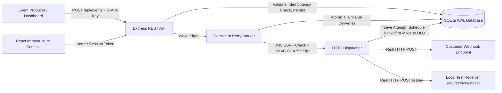

# HookRelay — Webhook Delivery & Reliability Platform

HookRelay is a self-hosted webhook delivery, signing, retry, and observability platform. It lets engineering teams register webhook endpoints, ingest events with idempotency guarantees, dispatch real HMAC-SHA256 signed HTTP POST requests, automatically retry transient failures with persistent exponential backoff, inspect complete request/response attempt timelines, manage Dead Letter Queues, replay events, and monitor reliability analytics.

## Main Features

- **Real Outbound HTTP Webhook Engine**: Persists events in SQLite, matches enabled endpoint subscriptions (`order.created`, `order.*`, `*`), and dispatches real HTTP POST requests with `X-HookRelay-*` headers.
- **HMAC-SHA256 Signing & Replay Protection**: Signs the exact transmitted raw JSON payload (`HMAC_SHA256(secret, timestamp + "." + rawBody)`), formats `X-HookRelay-Signature: t=...,v1=...`, and verifies with `crypto.timingSafeEqual` and configurable timestamp tolerance.
- **Persistent SQLite Retry Queue**: Background worker safely claims due deliveries with atomic locks, recovers stale locks on restart, respects HTTP `Retry-After` headers, and applies capped exponential backoff (`min(initialDelay * 2^(attempt-1), maxDelay)`).
- **Idempotency Guarantees**: Supports optional `Idempotency-Key` headers on event ingestion (rejecting payload mismatches with `409 Conflict`) and enforces delivery-level uniqueness via a partial SQLite unique index.
- **Dead Letter Queue & Event Replay**: Moves exhausted or permanently failed deliveries into the DLQ, preserves full historical attempt logs on manual replay, and lets developers replay any event to selected endpoints.
- **SSRF & Network Hardening**: Validates URL schemes, rejects embedded credentials, resolves destination DNS before dispatch, blocks private RFC1918/link-local/cloud-metadata IPs (`169.254.169.254`, `10.0.0.0/8`, `172.16.0.0/12`, `192.168.0.0/16`), disables automatic HTTP redirects, enforces request timeouts, and caps request/response payload sizes.
- **Built-in Local Webhook Receiver**: Real backend HTTP POST endpoint (`/api/receiver/ingest`) that verifies HMAC signatures on exact raw bytes and simulates HTTP `200`, `400`, `429` (with `Retry-After`), `500`, delayed responses, and timeouts.
- **Database-Backed Analytics & OpenAPI/Swagger**: Live SQLite aggregations across 24h, 7d, 30d, and custom date ranges plus interactive OpenAPI 3.0 documentation at `/api/docs`.

## Architecture



## Tech Stack

- **Frontend**: React 19, TypeScript, Tailwind CSS v4, Recharts, Lucide Icons
- **Backend**: Node.js 22, Express 4, TypeScript, Zod validation
- **Database**: SQLite via `better-sqlite3` (WAL mode, foreign keys, versioned migrations)
- **Cryptography**: Node.js native `crypto` (`HMAC-SHA256`, `scrypt`, `timingSafeEqual`, `randomBytes`)
- **API Documentation**: OpenAPI 3.0.3 + `swagger-ui-express` (`/api/docs`, `/api/openapi.json`)
- **Testing**: Vitest with real local HTTP test receivers and persistent SQLite databases

## Database Design

Managed via versioned migrations in `src/server/database/migrations.ts`:

| Table | Purpose |
| :--- | :--- |
| `endpoints` | Registered destinations, JSON subscription patterns, HMAC signing secret (redacted in GET APIs), enabled flag, last delivery status |
| `events` | Immutable event envelope (`id`, `type`, exact raw `payload`, optional `idempotency_key`, `source`) |
| `idempotency_keys` | Unique ingestion keys mapped to `event_id` and SHA-256 `request_hash` for conflict detection |
| `deliveries` | Persistent queue & state machine (`pending`, `processing`, `succeeded`, `retrying`, `failed`, `dead_letter`), `next_attempt_at`, worker lock fields, replay lineage (`replay_of_delivery_id`, `is_replay`), and partial unique constraint `UNIQUE(event_id, endpoint_id) WHERE is_replay = 0` |
| `delivery_attempts` | Immutable log of every HTTP attempt (redacted request/response headers, raw body, status code, latency, error code/message, outcome) |
| `application_settings` | Persistent retry policy, timeouts, SSRF localhost toggle, workspace metadata, and scrypt-hashed admin key (when claimed via UI) |
| `receiver_requests` | Persisted incoming webhook inspections for the built-in Local Webhook Receiver |

## Environment Variables

See `.env.example` for all supported variables:

```bash
PORT=3000
NODE_ENV=development
HOOKRELAY_API_KEY=                # Required for production; leave empty on first local run to claim via setup screen
HOOKRELAY_DB_PATH=./data/hookrelay.db
ALLOW_LOCALHOST_WEBHOOKS=true     # Must be false in production
WORKER_POLL_INTERVAL_MS=1500
WORKER_CONCURRENCY=5
WEBHOOK_REQUEST_TIMEOUT_MS=10000
WEBHOOK_MAX_RESPONSE_BYTES=65536
WEBHOOK_MAX_PAYLOAD_BYTES=262144
APP_URL="http://localhost:3000"
```

## Local Setup & Commands

```bash
# 1. Install dependencies
npm install

# 2. Configure environment variables
cp .env.example .env

# 3. Start full-stack dev server (Express API + Retry Worker + Vite React frontend on port 3000)
npm run dev

# 4. Run automated Vitest test suite (real HTTP receivers + SQLite persistence tests)
npm test

# 5. Typecheck & production build
npm run lint
npm run build
npm start
```

## API Examples

### Register an Endpoint

```bash
curl -X POST http://localhost:3000/api/endpoints \
  -H "Content-Type: application/json" \
  -H "X-API-Key: $HOOKRELAY_API_KEY" \
  -d '{
    "name": "Orders Fulfillment Service",
    "url": "http://127.0.0.1:3000/api/receiver/ingest",
    "subscribed_events": ["order.created", "order.cancelled"]
  }'
```

### Dispatch an Event with Idempotency

```bash
curl -X POST http://localhost:3000/api/events \
  -H "Content-Type: application/json" \
  -H "X-API-Key: $HOOKRELAY_API_KEY" \
  -H "Idempotency-Key: ord-1001-created" \
  -d '{
    "type": "order.created",
    "data": {
      "orderId": "ORD-1001",
      "amount": 1499,
      "currency": "INR"
    }
  }'
```

## Webhook Signature Verification Example (Node.js)

```ts
import crypto from 'crypto';

export function verifyHookRelaySignature(
  rawBody: string,
  signatureHeader: string,
  secret: string,
  toleranceSeconds = 300
): boolean {
  const parts = Object.fromEntries(
    signatureHeader.split(',').map((kv) => kv.trim().split('='))
  );
  const ts = Number(parts.t);
  const v1 = parts.v1;
  if (!Number.isInteger(ts) || !v1) return false;
  if (Math.abs(Math.floor(Date.now() / 1000) - ts) > toleranceSeconds) return false;

  const expected = crypto
    .createHmac('sha256', secret)
    .update(`${ts}.${rawBody}`, 'utf8')
    .digest('hex');

  const a = Buffer.from(expected, 'hex');
  const b = Buffer.from(v1, 'hex');
  return a.length === b.length && crypto.timingSafeEqual(a, b);
}
```

## Error Reporting Documentation

See [`docs/ERROR_REPORTING.md`](docs/ERROR_REPORTING.md) for the complete catalog of standardized API error codes, delivery failure classifications, retryability rules, and troubleshooting steps.

## Known MVP Limitations

- **Single-Node SQLite Queue**: SQLite WAL mode with atomic lock claiming provides durable persistence and concurrency safety on a single server node; horizontal multi-node worker fleets would migrate the queue/storage layer to PostgreSQL (`FOR UPDATE SKIP LOCKED`) or Redis Streams.
- **No Automated Secret Dual-Signing Window**: Secret rotation immediately activates the newly generated signing secret; dual-secret grace-period headers (`v1` + `v1_prev`) are planned for zero-downtime key rotation.
- **DNS Pinning Across Custom Sockets**: Pre-flight `dns.lookup(..., { all: true })` validates every resolved IP immediately prior to `fetch()`; enterprise deployments handling untrusted high-risk targets should also run outbound traffic through a dedicated egress proxy (e.g. Smokescreen).
